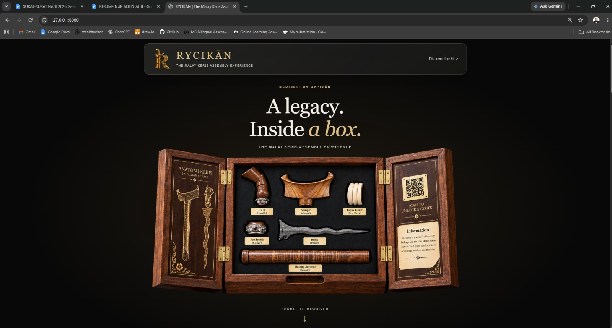
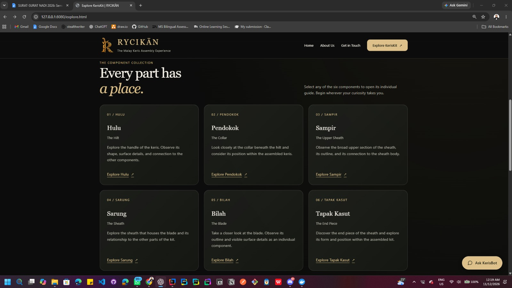
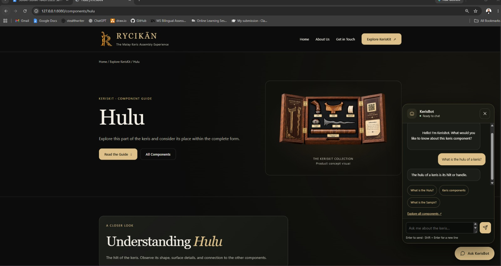

# KerisKit — Heritage Learning Platform

A full-stack heritage-learning prototype connecting a modular physical keris kit with digital component guides and an AI-powered educational chatbot.

The web interface uses the RYCIKĀN branding.

**Status: In active development. Not production-ready.**

## Overview

KerisKit helps users explore six keris components: Hulu, Pendokok, Sampir, Sarung, Bilah and Tapak Kasut.

KerisBot combines keyword-based retrieval from a structured knowledge collection with a locally hosted language model through Ollama.

## Implemented Features

- Landing page and component collection interface.
- Database-backed component detail pages.
- Spring Boot REST APIs and Thymeleaf templates.
- PostgreSQL database managed through Flyway migrations.
- Docker Compose configuration for local PostgreSQL.
- KerisBot chat interface with conversation history.
- Malay-English search-term mapping.
- Source retrieval and backend citation-label checks.
- Error handling for unavailable AI services and unsupported answers.

## Technology Stack

- **Language:** Java 25
- **Backend:** Spring Boot, Spring Data JPA
- **Frontend:** HTML, CSS, JavaScript, Thymeleaf
- **Database:** PostgreSQL 17
- **Schema migrations:** Flyway
- **Local AI:** Ollama
- **Build:** Maven
- **Database container:** Docker Compose

## KerisBot Architecture

User question → Keyword-based source retrieval → Retrieved excerpts and conversation context → Ollama → Backend citation-label checks → Chat response

Retrieval uses structured JSON knowledge chunks, keyword matching and Malay-English term mapping. It does not use a vector database or embeddings.

Citation-label checks verify that referenced labels belong to the retrieved sources. They do not independently verify that every generated claim is factually supported.

## Screenshots

### Landing Page



### Component Detail



### KerisBot Demo



## Verification So Far

- Clean compilation of 18 Java source files completed successfully using Java 25 and IntelliJ's bundled Maven 3.9.16.
- The application started successfully on port 8080.
- The landing page, component collection and Hulu detail page were opened manually.
- A chatbot question retrieved knowledge chunks and produced an Ollama response containing a source label in the backend log.

These checks demonstrate selected workflows, not comprehensive test coverage or overall answer accuracy.

## Local Setup

### Prerequisites

- JDK 25.
- Maven, or IntelliJ IDEA with bundled Maven.
- Docker Desktop with Docker Compose.
- Ollama for chatbot functionality.

### Configuration

Use `.env.example` as a reference for the required environment variables.

Set `KERISKIT_DB_PASSWORD` locally to the password used by your PostgreSQL database. Never commit the real password.

Other configurable variables include:

- `KERISKIT_DB_URL`
- `KERISKIT_DB_USERNAME`
- `KERISKIT_OLLAMA_BASE_URL`
- `KERISKIT_OLLAMA_MODEL`

Docker Compose can read a project-root `.env` file. Spring Boot does not automatically load that file with the current configuration: set the variables separately in the application's run environment.

For IntelliJ, configure them under:

**Run → Edit Configurations → Main → Environment variables**

Do not share screenshots containing the password.

### Start PostgreSQL

From the directory containing `compose.yaml`, with the required database password configured:

```powershell
docker compose up -d database
```

For an existing PostgreSQL volume, use its existing password. Changing the environment variable alone does not change the password stored in an already initialised database.

Do not delete the database volume to resolve configuration problems.

### Prepare Ollama

The default configured model is `llama3.2:3b`.

If it is not already installed:

```powershell
ollama pull llama3.2:3b
```

Ensure Ollama is running before using KerisBot.

### Build and Run — IntelliJ IDEA

1. Open the directory containing `pom.xml` as a Maven project.
2. Select JDK 25.
3. Configure the application environment variables.
4. Start PostgreSQL.
5. Run `com.keriskit.Main`.

To compile through the Maven tool window, select:

**keriskit → Lifecycle → compile**

### Build and Run — Maven CLI

If Maven is installed and available on PATH:

```powershell
mvn compile
mvn spring-boot:run
```

The current repository does not include a usable Maven Wrapper.

### Open the Application

- Home: http://127.0.0.1:8080/
- Component collection: http://127.0.0.1:8080/explore.html
- Hulu detail: http://127.0.0.1:8080/components/hulu

## Project Structure

- `src/main/java/com/keriskit/chatbot/` — chatbot orchestration, source retrieval and Ollama integration.
- `src/main/java/com/keriskit/component/` — component data access, services and controllers.
- `src/main/resources/templates/` — Thymeleaf page templates.
- `src/main/resources/static/` — static pages, styles, scripts and images.
- `src/main/resources/knowledge/` — structured knowledge collection.
- `src/main/resources/db/migration/` — Flyway migrations.
- `docs/screenshots/` — demonstration screenshots.
- `compose.yaml` — local PostgreSQL service configuration.

## Known Limitations

- Source labels are present in the observed backend answer but were not visible in the tested chat interface; frontend citation presentation requires further review.
- Chatbot accuracy, retrieval quality and response time require further evaluation.
- Knowledge content and visual assets are still being reviewed.
- Automated testing and deployment verification are not yet documented.
- Running the chatbot requires a local Ollama service and sufficient system resources.
- The platform is an educational prototype, not an authoritative historical reference.

## Content and Asset Notice

Knowledge excerpts and visual assets may be subject to third-party rights. Their inclusion in this project does not grant permission for redistribution or reuse.

## Author

Nur Adlin Auji binti Mohammed Zulkarnain

Universiti Utara Malaysia